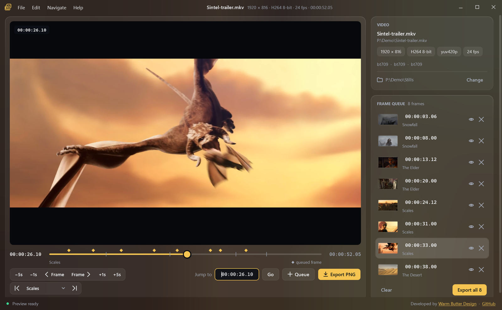
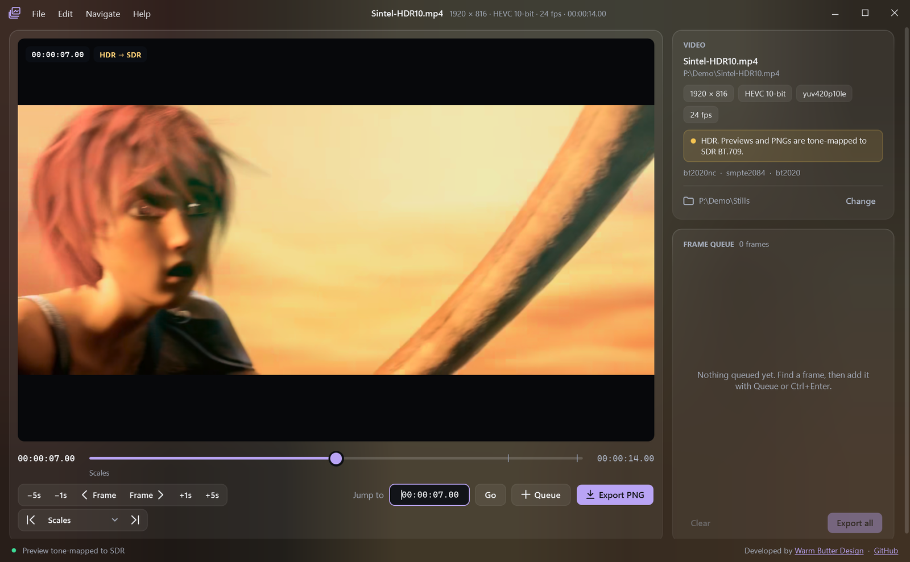
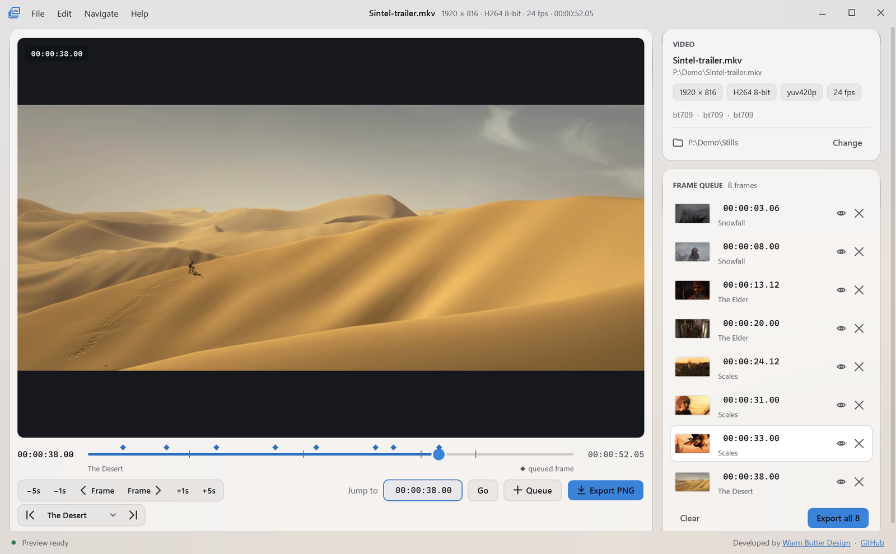
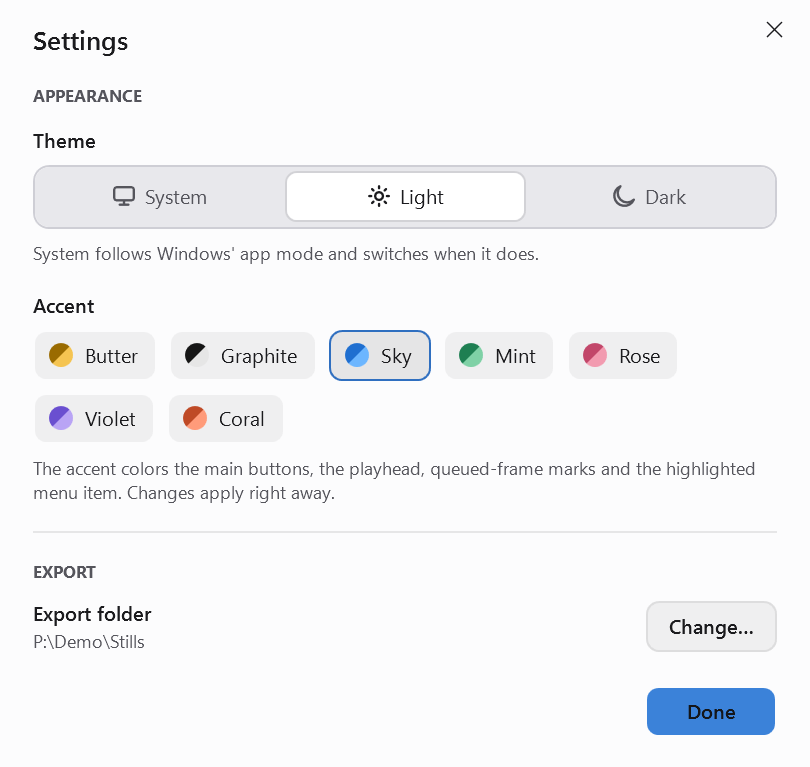
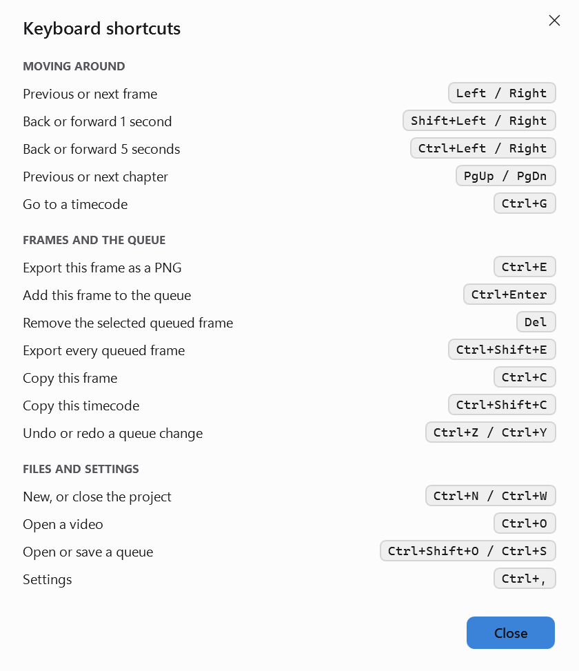

<p align="center">
  
</p>

<h1 align="center">FrameGrabber</h1>

<p align="center">
  <strong>The exact frame you want, as a full-resolution PNG, in seconds.</strong><br>
  A free, open-source Windows app for pulling clean stills out of any video, with no editing suite needed.
</p>

<p align="center">
  <a href="https://github.com/dgoldwas/FrameGrabber/releases/latest"><strong>⬇ Download for Windows</strong></a>
  &nbsp;·&nbsp;
  <a href="#full-feature-list">Features</a>
  &nbsp;·&nbsp;
  <a href="#version-log">What's new</a>
</p>



Screenshots of a paused player are soft, scaled to your monitor and stuck with whatever overlay the player draws. Opening an editor just to export one frame takes minutes. FrameGrabber does one job: drop in a video, land on the exact frame, and save a native-resolution PNG named after its timecode.

It's made for editors pulling reference frames, creators making thumbnails, archivists cataloguing footage, and anyone who has paused a video and wished the screenshot looked as good as the film.

## Why FrameGrabber

**🎯 Frame-accurate, not "close enough".** Step one source frame at a time, jump by 1 or 5 seconds, skip between chapters, or type a timecode such as `00:01:23.11`. What you see in the preview is exactly the frame you get.

**🖼 Full-resolution output.** Every PNG is rendered by FFmpeg at the video's native resolution: 1080p, 4K or more. It isn't a screen capture, so nothing is scaled down and no player controls get in the way.

**📋 Grab a whole shot list at once.** Queue as many frames as you like. Each one gets a thumbnail, its chapter and a mark on the timeline. Export them all with one click, or save the queue and pick up later.

**🌈 HDR that doesn't look washed out.** HDR10, HLG and Dolby Vision footage is detected and tone-mapped to SDR, so stills from HDR sources look right on any screen and in any document.



**⌨️ Built for speed.** Every action has a keyboard shortcut. Arrow keys step frames, Ctrl+Enter queues, Ctrl+E exports, and Ctrl+C copies the full-resolution frame straight to the clipboard to paste into Slack, Docs or Photoshop.

**✨ Looks at home on Windows 11.** A glass interface in light or dark, with seven accent colors. The window even takes a subtle tint from the frame you're on.



<table>
  <tr>
    <td width="50%"></td>
    <td width="50%"></td>
  </tr>
  <tr>
    <td align="center"><sub>Pick a theme, an accent and a default export folder</sub></td>
    <td align="center"><sub>Every command has a shortcut; press F1 for the full list</sub></td>
  </tr>
</table>

**🧰 Plays almost anything.** MKV, MP4, MOV, WebM, AVI, M4V and transport streams: if FFmpeg can read it, FrameGrabber can grab from it. If FFmpeg isn't installed, FrameGrabber offers to install it for you.

**🔄 Stays up to date.** FrameGrabber checks for new releases and installs them in one click.

## Get started in a minute

1. **[Download the installer](https://github.com/dgoldwas/FrameGrabber/releases/latest)** (`FrameGrabber-<version>-Setup.exe`) and run it.
2. Open FrameGrabber. If FFmpeg isn't on your PC yet, click **Yes** and it installs itself through `winget`.
3. Drag a video onto the window, find your frame, and press **Export PNG**.

Free and open source under the [MIT License](LICENSE). Windows 10 or later. See [Requirements](#requirements) for details.

<sub>Demo footage: <a href="https://durian.blender.org/">Sintel</a> trailer, © Blender Foundation, <a href="https://creativecommons.org/licenses/by/3.0/">CC BY 3.0</a>. Shown cropped, with chapter markers added, and as an HDR10 re-encode in the HDR screenshot.</sub>

---

## Full feature list

- Drag and drop video files directly onto the app.
- Browse for files when drag and drop is not convenient.
- Supports common FFmpeg-readable containers, including MKV, MP4, MOV, WebM, AVI, M4V, and transport streams.
- Scrub through the video with a timeline.
- Step forward or backward one source frame at a time.
- Jump between embedded video chapters when chapter metadata is available.
- Enter an exact frame timecode in `HH:MM:SS.frames` format, or enter seconds such as `93.5`.
- Automatically render a preview for the selected moment.
- Export a PNG at the source video's native resolution.
- Use a stable, recreation-friendly filename such as `scene-00-01-23.11.png`.
- Detect and display source resolution, codec, pixel format, color depth, color space, transfer, and primaries.
- Detect HDR10/PQ, HLG, wide-gamut BT.2020, and Dolby Vision metadata when FFprobe exposes it.
- Tone-map HDR and Dolby Vision frames to SDR BT.709 for both the preview and exported PNG.
- Choose a default export folder. The choice persists between launches.
- Build a queue of frames, edit queued timecodes, preview queue items, remove items, and batch-export them. The queue is always in timecode order. Queued frames show a thumbnail and their chapter, and appear as marks on the timeline.
- Undo and redo changes to the queue (Ctrl+Z, Ctrl+Y).
- Copy the current frame at full resolution (Ctrl+C) or its timecode (Ctrl+Shift+C) to the clipboard.
- Save queues as JSON and open them later to restore the source video and exact frame list. Opening a queue renders the thumbnails of its frames in the background.
- File › New (Ctrl+N) and File › Close project (Ctrl+W) return to an empty window. Closing a changed queue, whether by New, Close project, opening another queue, installing an update or closing FrameGrabber, first asks whether to save it.
- A menu bar (File, Edit, Navigate, Help) merged into the title bar, as in VideoTrimmer, with every command and its shortcut. Help › Keyboard shortcuts (F1) lists them all.
- Glass interface in light and dark themes with a choice of seven accents (Butter, Graphite, Sky, Mint, Rose, Violet, Coral), the same ones as RadioStudio and VideoTrimmer. Pick them in Edit › Settings (Ctrl+,); System follows Windows' app mode. The window takes a faint tint from the current frame.
- Open a video by passing its path on the command line, for example from Open with.
- Custom multi-resolution Windows application icon, "Lifted Frame": one still lifted out of a stack of frames. The title bar shows the same mark in the accent color. The artwork is `assets/FrameGrabber-icon.svg`; `assets/make-icon.ps1` rebuilds the `.ico` from its 1024 px PNG.

## Requirements

- Windows 10 or later.
- For the installer: FFmpeg/FFprobe on `PATH` or beside the app. .NET is included, and the installer does not bundle FFmpeg.
- For a normal source build: .NET 8 Desktop Runtime and FFmpeg/FFprobe beside the app or on `PATH`.
- For the single-file portable build: FFmpeg/FFprobe beside the app or on `PATH`; .NET is included.
- For a locally built, FFmpeg-bundled executable: no separate .NET or FFmpeg installation.

FrameGrabber uses the `ffmpeg` and `ffprobe` command-line tools rather than embedding a media library. This keeps the application small and lets FFmpeg provide broad codec and container support.

FrameGrabber first looks for `ffmpeg.exe` and `ffprobe.exe` beside its own executable, then on `PATH`. The optional locally built FFmpeg-bundled version embeds both command-line tools in one executable. On first run, it extracts them to `%LOCALAPPDATA%\FrameGrabber\tools` so Windows can launch them. .NET may also extract runtime files to `%TEMP%\.net`.

## Installing FFmpeg

FrameGrabber never ships FFmpeg. Install an FFmpeg Windows build that includes both `ffmpeg.exe` and `ffprobe.exe`, then add their `bin` directory to your system or user `PATH`. You can also place the files beside `FrameGrabber.exe`; when it is installed under `C:\Program Files`, that folder needs administrator rights to write to.

Verify the installation from PowerShell:

```powershell
ffmpeg -version
ffprobe -version
```

If either command is not recognized and the tools are not beside FrameGrabber, restart FrameGrabber after updating `PATH`.

On startup, FrameGrabber checks for both tools. If either is missing, it offers to install the Gyan FFmpeg Essentials package (`Gyan.FFmpeg.Essentials`) automatically with `winget`. The installation requires Windows Package Manager to be available and may require restarting FrameGrabber before the refreshed `PATH` is visible.

## Running from source

Clone the repository, open a PowerShell window in the project folder, and run:

```powershell
dotnet restore
dotnet run
```

To create a Release build:

```powershell
dotnet publish -c Release --no-restore
```

The published executable is written to:

```text
bin\Release\net8.0-windows\publish\FrameGrabber.exe
```

## Installer

To build the Windows installer, run:

```powershell
.\build-installer.ps1
```

This needs the .NET 8 SDK and [Inno Setup 6](https://jrsoftware.org/isinfo.php), and writes `artifacts\FrameGrabber-<version>-Setup.exe`. The installer puts FrameGrabber in `C:\Program Files\WarmButter\FrameGrabber`, adds a Start Menu shortcut (and an optional desktop shortcut), and requires administrator permission. It does not include FFmpeg; FrameGrabber uses the FFmpeg on your `PATH` (or beside the exe), or offers to install it through `winget`. A copy installed by an earlier release in `C:\Program Files\FrameGrabber` is removed when you install over it. Your settings in `%LOCALAPPDATA%\FrameGrabber` are left in place, including after an uninstall.

- `-Install` installs the new build after compiling it.
- `-Release` publishes the installer as GitHub release `v<version>`. Commit first, so the tag matches the build.

**Help › Check for updates** looks for the latest GitHub release. FrameGrabber also checks shortly after it starts and every six hours. When a newer release exists, a dot appears on **Help** and the item becomes **Update to …**; choosing it downloads the installer, checks its SHA-256, closes FrameGrabber, installs through a Windows permission prompt, and reopens. The queue is not kept across an update, so save it first. Updates always install to the Program Files location, even if you run the check from a portable copy.

## Single-file portable build

For an installer-free copy, build a single executable without third-party media binaries by running:

```powershell
.\publish-release.ps1
```

This writes `dist\release\FrameGrabber.exe`. It runs without an installed .NET runtime. Put `ffmpeg.exe` and `ffprobe.exe` beside it after obtaining those tools from their distributor, or let FrameGrabber offer to install them through `winget`.

To build a fully self-contained executable for your own use, on a Windows build machine with .NET 8 SDK, FFmpeg, and FFprobe installed, run:

```powershell
.\publish-portable.ps1
```

The script writes `personal-release\FrameGrabber-v<version>-personal.exe`. The script uses the FFmpeg executables on `PATH`; pass `-FfmpegExe` and `-FfprobeExe` to select other builds. It embeds those binaries at publish time, and Git ignores the resulting executable. The resulting executable is for Windows x64 and is substantially larger than the normal build.

The installed Gyan Essentials build tested for this project identifies itself as GPLv3, statically links many libraries, and uses `--enable-gpl`. The locally bundled executable is for personal use only unless you have resolved FrameGrabber's licensing and the corresponding-source obligations for the exact FFmpeg build. It is not a release artifact. The public release (the installer) includes FrameGrabber without FFmpeg binaries; users can obtain FFmpeg from its distributor. See [FFmpeg's legal guidance](https://ffmpeg.org/legal.html) and [GNU's GPL FAQ](https://www.gnu.org/licenses/gpl-faq.en.html).

## Using FrameGrabber

1. Launch FrameGrabber.
2. Drop a video onto the window, or select **Open video** / **Browse files**.
3. Review the metadata in the **Video** panel.
4. Move the timeline, use the transport buttons, or enter a timecode and press **Enter** or **Go**.
5. Check the preview image. HDR and Dolby Vision sources are labeled and shown through the SDR tone-map.
6. Choose an export location with **Change** if needed.
7. Select **Export PNG**.

Below about 980 pixels wide, the details and queue stack under the preview and the page scrolls. Transport buttons wrap instead of clipping.

### Building a frame queue

Select **Add current frame** whenever the preview is on a frame you want to keep. Each queue row can be edited directly, shown, moved up or down, or removed. **Export all** batch-renders the queue to the selected export folder. **Save** writes a portable JSON file containing the source path and timecodes; **Import** restores it for later re-export.

### Keyboard

With a video loaded, and focus outside a text box or chapter list:

- Left / Right moves one frame. Shift moves one second. Ctrl moves five seconds.
- Ctrl+O opens a video. Ctrl+E exports the current frame. Ctrl+Enter adds it to the queue.
- Enter in the timecode box jumps to that time. Use `HH:MM:SS.frames` or a number of seconds.

The frame and chapter buttons use the video's reported frame rate and chapter metadata. If a file has no chapters, the chapter controls remain inactive.

Exports are saved as:

```text
original-filename-HH-MM-SS.frames.png
```

Colons are replaced with hyphens so the filename is valid on Windows and remains easy to map back to the original timecode.

## HDR and Dolby Vision handling

FrameGrabber reads stream metadata through FFprobe. When a source is identified as HDR or Dolby Vision, the frame is converted through an FFmpeg linear-light tone-map and output in SDR BT.709 RGB PNG format. This means the exported PNG is suitable for normal SDR applications and displays.

HDR metadata detection depends on what is present in the source stream. A file with missing or stripped metadata may be reported as SDR even if its origin was HDR.

Regular SDR sources are exported without tone-mapping. A 10-bit SDR source remains treated as SDR when its transfer and primaries indicate SDR.

## Project structure

```text
FrameGrabber.csproj   WPF/.NET project definition
App.xaml              Shared colors and control styles
MainWindow.xaml       Main application layout
MainWindow.xaml.cs    UI events and application workflow
MediaService.cs       FFprobe metadata and FFmpeg frame extraction
Models.cs             Video metadata model
UpdateService.cs      GitHub release check and update installer launch
MainWindow.Updates.cs Help menu update item and flow
installer\            Inno Setup script; build-installer.ps1 builds and releases it
publish-release.ps1   Single-file executable without FFmpeg (dist\release)
publish-portable.ps1  Personal single-file build with FFmpeg embedded (personal-release)
```

## Versioning and releases

FrameGrabber uses date-based release versions in the format `vYYYY.MM.DD`. If another release is made on the same date, use a variant suffix such as `v2026.09.12.1`, then `v2026.09.12.2`. The version is set in one place, `<Version>` in `FrameGrabber.csproj`; `build-installer.ps1 -Release` tags `v<Version>`, and the update check compares against it.

## Version log

### v2026.11.16.1

- New app icon, "Lifted Frame": one still lifted out of a stack of frames. The title bar shows the same mark in the accent color.
- File › New (Ctrl+N) and File › Close project (Ctrl+W) return to an empty window.
- A changed frame queue is no longer lost without warning: New, Close project, opening another queue, installing an update and closing FrameGrabber first offer to save it.
- Opening a saved queue renders the thumbnails of its frames.

### v2026.11.16

- New glass interface with the menu bar merged into the title bar, as in VideoTrimmer: File, Edit, Navigate and Help hold every command with its shortcut, and Help › Keyboard shortcuts (F1) lists them.
- Light and dark themes with seven accents, chosen in Edit › Settings (Ctrl+,); System follows Windows. Settings also holds the export folder.
- The window takes a faint tint from the current frame; the timeline marks chapter starts and queued frames.
- Queued frames show a thumbnail and their chapter. Queue changes can be undone and redone (Ctrl+Z, Ctrl+Y).
- Copy the current frame (Ctrl+C) or its timecode (Ctrl+Shift+C); go to a timecode with Ctrl+G; step chapters with Page Up and Page Down.
- Check for updates moved to the Help menu, which shows a dot when an update is waiting.

### v2026.11.09.1

- The installer now installs to `C:\Program Files\WarmButter\FrameGrabber` and removes the earlier `Program Files\FrameGrabber` copy.

### v2026.11.09

- Added a Windows installer (`build-installer.ps1`) that installs to Program Files without bundling FFmpeg.
- Added **Check for updates**, which finds the latest GitHub release and installs it.

### v2026.10.20

- Refined the main window so the preview, transport, video details, and queue stay usable on a narrower window. Below about 980 pixels, the side panel stacks under the preview.
- Added keyboard transport: Left and Right step one frame, Shift steps one second, Ctrl steps five seconds, Ctrl+O opens a video, Ctrl+E exports the current frame, and Ctrl+Enter adds it to the queue.
- Restored the chapter bar. Videos with chapter metadata show the chapter title, and Previous and Next step between chapters.
- Fixed frame timecodes so the clock, Show, and queue export all use the same `HH:MM:SS.frames` frame. On 23.976, 29.97, and 59.94 footage, the frame field is counted at the rounded rate instead of being added as a fraction of a real second.
- Seek previews and exports with a microsecond timestamp so FFmpeg returns the requested frame.

### v2026.09.23

- Added support for FFmpeg and FFprobe placed beside FrameGrabber, allowing an installer-free setup without changing `PATH`.
- Added self-contained single-file publishing and an optional local build that embeds FFmpeg tools.
- Documented FFmpeg redistribution requirements; public release assets do not include FFmpeg binaries.

### v2026.09.12.1

- Added frame-forward and frame-backward navigation.
- Added one-second and five-second seek controls.
- Added chapter navigation and automatic chapter-selector synchronization.
- Added editable frame queues with preview, remove, reorder, import, export, clear, and batch PNG export actions.
- Added direct timeline click seeking.
- Added a custom Windows application icon and refined dark ComboBox styling.
- Added a persistent default export folder.

### v2026.09.12

- Initial FrameGrabber release.
- Added drag-and-drop video loading, FFmpeg metadata inspection, frame preview, HDR/Dolby Vision SDR tone-mapping, native-resolution PNG export, and timecode-based filenames.

## License

FrameGrabber is released under the [MIT License](LICENSE). FFmpeg is not part of FrameGrabber and is covered by its own license.
